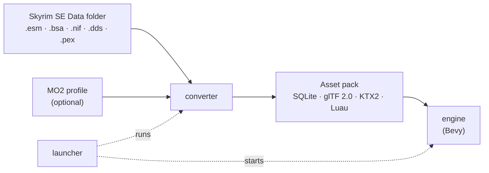

<h1 align="center">
  
</h1>

<p align="center">
  <strong>An open-source engine reimplementation for <em>The Elder Scrolls V: Skyrim Special Edition</em>, written in Rust on Bevy.</strong>
</p>

<p align="center">
  <a href="https://github.com/Mudcrab-Team/mudcrab/actions/workflows/run_tests.yml"></a>
  <a href="LICENSE"></a>
  <a href="https://discord.gg/29GRf8QShH"></a>
  
</p>

<p align="center">
  <a href="#quick-start">Quick start</a> ·
  <a href="#documentation">Documentation</a> ·
  <a href="#roadmap">Roadmap</a> ·
  <a href="CONTRIBUTING.md">Contributing</a> ·
  <a href="https://discord.gg/29GRf8QShH">Discord</a>
</p>

Mudcrab is a new engine for Skyrim, built from the ground up with full 1:1 parity as the goal: the
game should look, play and feel exactly like the Skyrim you know. Inspired by engine
reimplementations like OpenMW, Mudcrab converts Skyrim's older file formats into modern ones, so
the engine can use today's game development techniques.

On top of that, Mudcrab adds optional enhancements built on Bevy's modern engine features. Install
them like any other mod, or leave them out for the original experience. They are made for Mudcrab
and don't work in the original game by default, but we encourage anyone who wants them there to
find a way.

Mudcrab supports mods that don't need SKSE. We'll explore broader SKSE support after release.

**Status: early development.** The converter handles a full Skyrim SE install, and the engine
streams the converted world for you to walk through. Skyrim is not playable as a game yet; see the
[roadmap](#roadmap).

> [!IMPORTANT]
> Mudcrab ships no game assets. You need a legally owned copy of Skyrim Special Edition to supply
> game data. Mudcrab is not affiliated with or endorsed by Bethesda Softworks, ZeniMax Media, or
> Microsoft. See [LEGAL.md](LEGAL.md).

## Features

- **Convert once, play from modern formats.** Plugins become a SQLite world database, meshes become
  glTF 2.0, textures become KTX2, and Papyrus scripts are transpiled to Luau. Reconversion reuses
  unchanged assets.
- **A streaming open world.** Cells load around the player from an R-tree spatial index. Load doors
  fade through black while the destination loads.
- **First-person movement with collision.** Walk the world on Rapier physics, with a noclip
  fallback.
- **Mod Organizer 2 profiles.** Convert an MO2 profile in place, overlaid on your Data folder.
- **GPU texture encoding.** An optional wgpu compute encoder cut a full conversion from 28 to 9
  minutes on its author's machine ([details](docs/guides/converter.md#gpu-texture-encoding)).
- **Repairable conversions.** `repair-failed` re-converts only what failed, previews the result, and
  publishes with a rollback journal.
- **No game needed to contribute.** `dummy-content` generates a synthetic game to test the full
  pipeline.

## Quick start

### Prerequisites

- **Rust** via [rustup](https://rustup.rs). [`rust-toolchain.toml`](rust-toolchain.toml) pins the
  toolchain, and rustup installs it on the first build.
- **A C and C++ compiler** for the bundled SQLite, Luau and Basis Universal sources: Visual Studio
  Build Tools on Windows, Xcode Command Line Tools on macOS, GCC or Clang on Linux.
- **Linux only:** Bevy's [system libraries](https://github.com/bevyengine/bevy/blob/main/docs/linux_dependencies.md).
  With [devenv](https://devenv.sh), `devenv shell` provides them.
- **A GPU** with Vulkan, DirectX 12 or Metal support.
- **Disk space:** 20–30 GB for build output. See
  [build and conversion requirements](docs/specs/meta/requirements.md) for times and sizes.

### Play with your Skyrim install

1. Clone the repository and build the engine and launcher:

   ```bash
   git clone https://github.com/Mudcrab-Team/mudcrab.git
   cd mudcrab
   cargo build --release --bin engine --bin launcher
   ```

2. Start the launcher:

   ```bash
   cargo run --release -p launcher
   ```

3. The launcher finds a Steam install of Skyrim SE. If it doesn't, drop your Skyrim `Data` folder
   onto the window. Converted assets go to `modern_assets` unless you drop a different Output
   folder.
4. Press **Start** to convert. A first conversion takes a while; later runs reuse unchanged
   assets.
5. Press **PLAY MUDCRAB** when the conversion completes.

The launcher starts the engine binary built next to it, so build both with the same profile. To
convert a Mod Organizer 2 profile instead, see
[Convert a Mod Organizer 2 profile](docs/guides/converter.md#convert-a-mod-organizer-2-profile).

### No Skyrim? Use synthetic data

Generate a small synthetic game, convert it, and open it in the engine:

```bash
cargo run -p dummy-content -- gen Data
cargo run -p converter --bin converter -- Data modern_assets
cargo run -p engine --bin engine -- --assets modern_assets --worldspace 1
```

The fixture contains no copyrighted content. Its worldspace is form id `1`; the engine's default is
Skyrim's Tamriel, which the fixture does not contain.

## Documentation

| Read this | For |
| :-- | :-- |
| [Converting game data](docs/guides/converter.md) | Converter command line, MO2 profiles, repairing a conversion, GPU texture encoding |
| [Running the engine](docs/guides/engine.md) | Engine options, WALK and NOCLIP startup |
| [Technical specifications](docs/specs/README.md) | Formats, converters, engine architecture, launcher |
| [Roadmap](docs/roadmap/README.md) | Phase plans and acceptance criteria |
| [Architecture decision records](docs/adr/README.md) | Why the code is the way it is |
| [Build and conversion requirements](docs/specs/meta/requirements.md) | Build times, conversion times, disk space |

<details>
<summary>All technical specifications</summary>

- [`architecture.md`](docs/specs/engine/architecture.md): core engine architecture and phase milestones.
- [`nif-to-gltf.md`](docs/specs/converters/nif-to-gltf.md): 3D mesh converter (`mesh-tools`).
- [`dds-to-ktx2.md`](docs/specs/converters/dds-to-ktx2.md): texture compressor (`basis-universal` + `ddsfile`).
- [`esm-to-sqlite.md`](docs/specs/converters/esm-to-sqlite.md): master database (SQLite + `rkyv`).
- [`pex-to-lua.md`](docs/specs/converters/pex-to-lua.md): Papyrus bytecode to Luau transpilation (`mlua`).
- [`mods-and-ui.md`](docs/specs/modding/mods-and-ui.md): integrated mod manager and Flash-to-Bevy UI strategy.
- [`launcher.md`](docs/specs/modding/launcher.md): first-run setup wizard and launcher workflow.
- [`vercidium-optimizations.md`](docs/specs/engine/vercidium-optimizations.md): GPU instancing and HZB culling.
- [`platforms.md`](docs/specs/meta/platforms.md): target matrix for desktop, mobile ARM64 and WebGPU.
- [`requirements.md`](docs/specs/meta/requirements.md): build and conversion requirements.
- [`features.md`](docs/specs/modding/features.md): planned capabilities (no loading screens, AI dialogue, co-op).
- [`bevy-examples.md`](docs/specs/engine/bevy-examples.md): official Bevy 0.19 patterns mapped to engine subsystems.

</details>

## How it works



The converter does the heavy work offline, so the engine only reads formats a GPU and a database
understand directly. The workspace is split into these crates:

| Crate | Role |
| :-- | :-- |
| [`launcher`](crates/launcher) | Desktop app: finds Skyrim, runs conversions, starts the engine. |
| [`converter`](crates/converter) | Offline asset pipeline: `.esm` to SQLite, `.nif` to glTF 2.0, `.dds` to KTX2, `.pex` to Luau. |
| [`engine`](crates/engine) | Bevy game binary: streaming, rendering, physics. |
| [`shared`](crates/shared) | Versioned data contracts shared by the converter and the engine. |
| [`mo2`](crates/mo2) | Read-only Mod Organizer 2 instance and profile resolution. |
| [`dummy-content`](crates/dummy-content) | Deterministic synthetic game data for tests and CI. |

## Roadmap

Mudcrab is built in five phases. The full plans are in [`docs/roadmap/`](docs/roadmap/README.md).

- [x] **[Phase 1: Asset modernization pipeline](docs/roadmap/01-asset-pipeline.md).** Transpile
  legacy `.esm`, `.nif`, `.dds` and `.pex` into SQLite, glTF 2.0, KTX2 and Luau.
- [ ] **[Phase 2: Core engine runtime and Vercidium renderer](docs/roadmap/02-core-engine.md).**
  Runtime, integration, profiling and acceptance infrastructure are implemented; real-asset
  sign-off is pending.
- [ ] **[Phase 3: Luau runtime, declarative UI and launcher](docs/roadmap/03-luau-and-ui.md).**
  Sandboxed Luau with async web APIs, Flash-to-Bevy `bsn!` UI conversion, and the setup wizard.
- [ ] **[Phase 4: Gameplay, physics and persistence](docs/roadmap/04-gameplay-and-physics.md).**
  Rapier 3D physics, animation blending, combat, and save-state snapshots.
- [ ] **[Phase 5: Ray tracing, multiplatform and networking](docs/roadmap/05-multiplatform-and-networking.md).**
  Ray-traced global illumination, DLSS/FSR3 frame generation, co-op multiplayer, Android ARM64 and
  OpenXR VR.

## Contributing

Contributions are welcome: converter fixes, rendering work, tests, and documentation. Read
[CONTRIBUTING.md](CONTRIBUTING.md) for the workflow, then run what CI runs before opening a pull
request:

```bash
cargo fmt --all -- --check
cargo clippy --workspace --all-targets --all-features -- -D warnings
cargo nextest run --workspace --all-targets --no-fail-fast --no-tests=warn
```

- Used an AI assistant? Follow the [AI policy](docs/AI_POLICY.md).
- Found a bug? Search the [issue tracker](https://github.com/Mudcrab-Team/mudcrab/issues) or open
  an issue.
- Have a question? Ask on [Discord](https://discord.gg/29GRf8QShH).
- Never commit game assets. See [LEGAL.md](LEGAL.md).

## License and legal

Mudcrab is licensed under the [GNU General Public License v3.0 or later](LICENSE)
(`GPL-3.0-or-later`).

Mudcrab is an independent open-source game engine reimplementation. It does **not** contain or
distribute any copyrighted game assets, artwork, 3D models, audio, or game data belonging to
Bethesda Softworks LLC or ZeniMax Media Inc. You must supply your own legally owned copy of
_The Elder Scrolls V: Skyrim_ to extract game data.

"The Elder Scrolls" and "Skyrim" are registered trademarks of Bethesda Softworks / ZeniMax Media.
All trademarks are the property of their respective owners and are used strictly under nominative
fair use for compatibility description. Read the full statement in [LEGAL.md](LEGAL.md).
