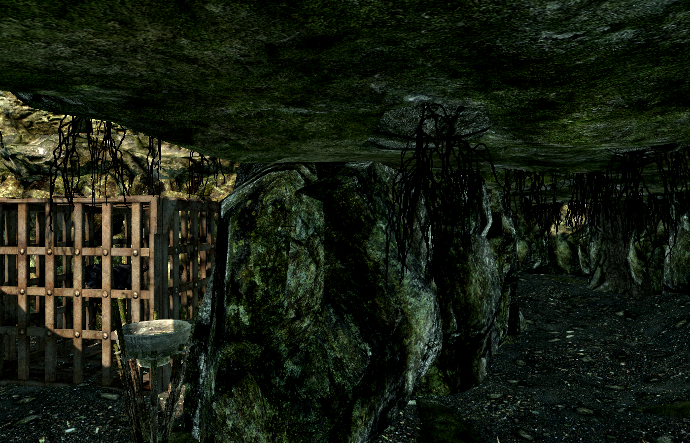

# Independent occluder follow-up validation

This change applies authored static plane and box occluders to the main camera's mesh list.
It is a follow-up to #656, based on `e36bba2a`, rather than part of the web/foliage eligibility fix.
The original local work was based on `9ab2faab`; the port preserves the later source-rejection,
near-plane, incomplete-cell, dangling-link, assignment, and room-gap review fixes.

## Contract

Full trusted conversion publishes `occlusion_version=1`. Earlier packages retain their existing
behavior. Supported independent occluders contribute exclusions to their owning joined room or
unbounded space. Contributions remain local to each portal path, so a separate clear path can
retain the same mesh. Exclusion requires full containment of a sphere enclosing the transformed
mesh AABB; partial overlap and uncertain bounds retain geometry.

Roomless interiors can apply verified independent occluders to the camera volume. Occluders do
not establish portal coverage in interiors with rooms: a camera outside every authored room
still keeps full rendering. The room-gap regression exercises this with an occluder present.

Linked primitives and known incoming targets, enable-parent/state-controlled shapes, explicit
primitive overrides, and ambiguous ownership remain inactive. Lights, shadows, physics, and
streaming are outside this filter. Exact native traversal order, bounds, activation updates,
and Boolean construction for linked shapes remain separate parity questions.

The native evidence and its executable/tool identities are summarized in
[the REA investigation](skyrim-culling-rea-parity.md). That investigation retains its original
baseline. Its static analysis is not a controlled original-game object-submission comparison.

## Automated validation

Linux/NixOS, Rust 1.98.1. The engine library passes 1,663 tests with 11 ignored; the converter
library passes 1,232 with 30 ignored. The selected integration suites pass 13 master-index,
20 schema-addon, 38 reference (one ignored), two recovered-metadata/archive, and four snapshot
tests. All seven capture-utility tests pass. Formatting and strict engine/converter library,
test, and capture-example Clippy pass.

The geometric tests include an independent segment/box intersection oracle, perspective and
orthographic views, boundary contact, shear/nonuniform scale, separate portal paths, and local
exclusions surviving budget widening. ECS tests exercise the real mesh-list filter and its
independence from light lists. Export tests cover malformed source state, invalid geometry,
source identity, version gating, and retained-asset compatibility across the metadata adapter.

## Visual controls

The executable, camera, input-database identities, completed checks, capture receipts, and image
comparisons are recorded in [validation.json](evidence/occluders-20261117/validation.json).
The [shot file](evidence/occluders-20261117/smoke-shots.json) selects the Lost Knife entry viewpoint.
The control removes only `room_graph_stats.occlusion_version` from an independent metadata copy;
converted meshes, textures, lighting inputs, and camera settings are shared. Input databases are
hashed before and after each run. Runs alternate on, off, off, on after settled loading.

Both repetitions list 1,196 main-camera meshes. Occlusion retains 873; disabling the occlusion
version marker retains all 1,196. Both on/off pairs and both within-mode repeat comparisons
are pixel-identical at 1400×900. These numbers belong to executable
`00db7822a44fd78bd44b7a9526057f08faa63519836341239b74c2c5f69c5aad`.

These controls examine rendered appearance and camera mesh-list selection. The executable uses
the test profile (opt-level 1) with no measurement-only patch. They are not a frame-time benchmark,
and fewer listed meshes do not establish a proportional performance improvement. The earlier
2026-11-16 comparisons used a different executable and remain historical evidence, not validation
of this port. A small sampled visual control cannot establish complete Skyrim parity.
