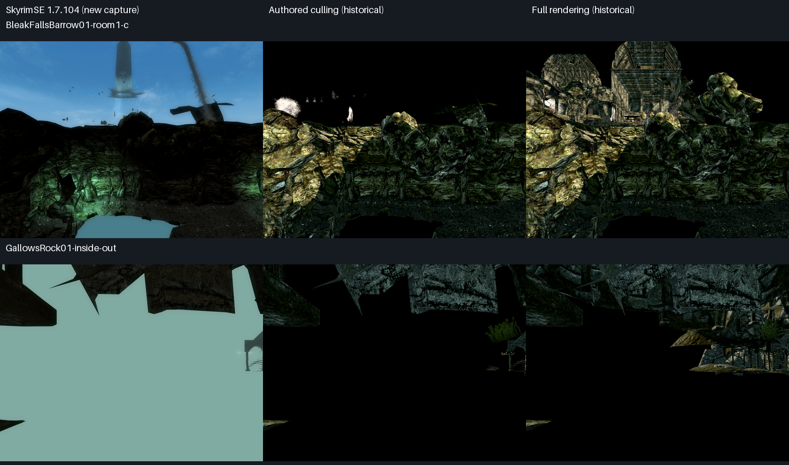
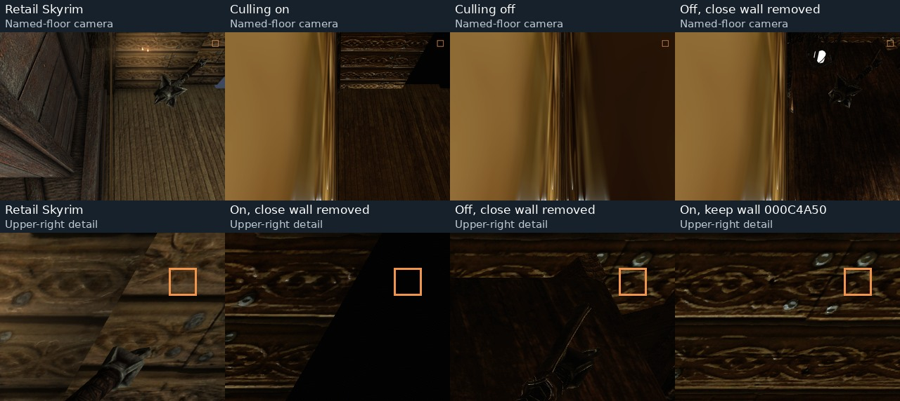
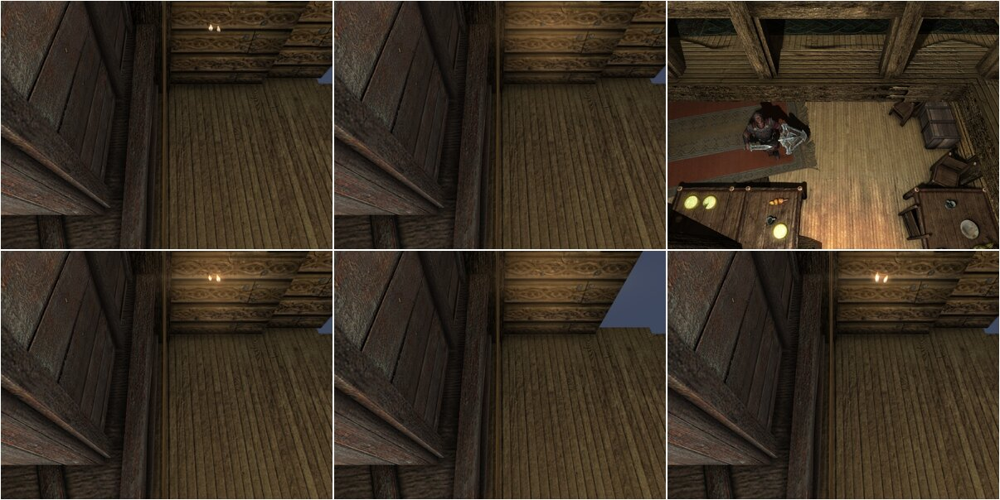

# Authored-assignment retail comparison, 2026-11-17

Fresh original-game captures support the two background-shell removals questioned in review.
Skyrim omits those shells at the matched viewpoints too. This supplies the missing retail oracle for these removals. Authored assignment remains enabled
by default. The comparison does not establish full Skyrim parity.

## Retail oracle for the disputed images

The original game is SkyrimSE.exe 1.7.104.0 under Proton Experimental 11.0-100. Its SHA-256 is
`846efccf0c1374d71f892907f46549560f2fcb0a75cb87a3eed438baa0f1402f`.
Built-in `tfc 1` supplied the free camera. Read-only native probes checked NiCamera RTTI, position,
rotation, field of view, cell, and enabled multibounds before and after every capture.

The 15 retail captures cover five poses three times at 1400×1050. Position errors are below 0.02
Creation units and angular errors below 0.002 degrees. A private Proton prefix disabled autosaves.
The installed executable, preferences, and saves matched all nine pre-run hashes after normal exit.
No debugger attachment or instruction patch was used.
[Executable and camera receipts](evidence/room-review-20261117/retail-captures.json) retain the evidence.



The middle and right columns reuse the historical authored runtime from
[the original validation record](room-authored-assignment-20261115.json), rather than relabeling a
newer combined build as that older layer. Their binary and image hashes are in
[the review receipt](evidence/room-review-20261117/authored-review.json).

At Bleak Falls `room1-c`, the large Nordic room shells in the full-render control are absent in
both retail and authored rendering. At Gallows `inside-out`, retail retains the foreground ceiling
edges and the small right-hand opening while omitting the large shell behind it. Authored rendering
makes the same broad visibility choice. Fog, sky, lighting, some props, and material sampling differ.
This is a geometry-visibility comparison, not an RGB parity measurement.

## Named targets and NONE in Katariah

Katariah01 contains 32 named targets, three NONE overrides, 2,536 automatic rules, and 18 unknown
rules. All five selected cells exported complete. The private fixture rebuilt 1,206 source models.
Unknown rules remain conservative.


The NONE-floor pose is above reference 769925. In the combined-stack build at `4de561be` with the
measurement patch, its floor remains visible in all three modes while room culling reduces the
draw count from 153 to 63.
The named-floor pose is above reference 457767, whose authored target is room 454223 while the
camera lies in room 454224. Its floor remains visible in retail and the enabled view, with 48 of
255 meshes retained. The full-render control covers much of that view with a close shell surface.
The side-by-side captures show differences in props and material sampling between Skyrim and
both Mudcrab modes. The wall-scale controls below identify the carved wall.
[Retail camera and image receipts](https://github.com/aivv73/mudcrab/blob/baca8725601b4492b08e4bd4f27677673b9f9946/docs/research/evidence/room-review-20261117/retail-captures.json#L1498-L1863) ·
[Mudcrab named-floor draw count](https://github.com/aivv73/mudcrab/blob/baca8725601b4492b08e4bd4f27677673b9f9946/docs/research/evidence/room-review-20261117/authored-review.json#L65-L71)

The fresh combined-stack recheck has 48 settled images at eight poses, three runs per mode.
It includes the review toggle and gap fixes plus the upper layer's bounds support. It is recorded
as a combined check, not a standalone rerun of #745. [Inputs, counts, comparisons, and hashes](evidence/room-review-20261117/authored-review.json)
retain that distinction. Local plane/box occluders are absent from both historical and current
executables used here. The broader traversal, lighting, shadows, and moving-deformation limits
remain in the existing research notes.

## Legacy bounds eligibility follow-up

The stored-model-bounds guard applies only to legacy geometric membership. Authored initial
named targets still supply ownership without a model sphere or legacy aggregate bounds. Authored
source spheres still drive ownership and movement updates without that legacy metadata. ECS
controls cover both cases alongside the spanning-floor regression for legacy graphs. This layer
passed all 82 room-culling-related tests after propagation. The retail images above retain their
recorded executables and were not rerun for this missing-metadata guard.

## Assignment cache invalidation

Cached ownership now recomputes whenever the computed cell-local affine transform changes.
A fixed tolerance on matrix entries cannot bound sphere displacement: scaling a source sphere
centered at x=9998 by 1.0005 moves it about five units. The regression keeps one scheduled
system and its local cache across two frames, then verifies reassignment into the visible room.
It failed before the fix and passes afterward; all 84 culling-related tests on the assignment
layer pass. The existing retail captures predate this change and were not rerun.

## Private fixture path validation

The preparation utility checks the supplied asset directory and every ancestor, using an absolute
path, before writing the preparation receipt or opening SQLite for writes. Database hard-link
and direct child-link checks remain in place. The linked-parent regression failed before the fix;
all five utility tests now pass. An actual CLI run with disposable files rejected the linked
ancestor before any write, preserving both the database bytes and an existing receipt. No game
assets were used in that check.

## Subset model replacement

A subset export that changes or removes an existing base model now removes that base's cached
source sphere and marks every referencing cell incomplete in the same transaction. A full room
export rebuilds completeness. Unchanged models retain their spheres and cell metadata; unrelated
bases and cells are untouched. A light that loses its model also loses its old drawable row.

The nonempty-subset regression failed when replacing `A.nif` with `B.nif`: the old sphere survived.
It now covers replacement, removal, and unchanged-model updates for both `STAT` and modeled `LIGH`
records, including affected cells and unrelated controls. This regression checks the derived ownership metadata.
The existing screenshots predate the subset fix.

## Katariah wall control, 2026-11-19

Skyrim draws carved wood from wall `000C4A65` in the upper-right corner of the named-floor view.
The original Mudcrab run omits this wall at the final drawable visibility test.
At the NONE-floor pose, room culling removes 95 main-camera meshes and leaves the entire PNG identical.

| Settled camera pose | Meshes with room culling | Meshes without room culling |
| --- | ---: | ---: |
| NONE floor | 58 | 153 |
| Named floor | 39 | 255 |

Both modes used the November 19 build at `d2a0b8e9` and its private pack with 236 rebuilt Katariah01
models. The November 17 comparison used a five-cell pack with 1,206 rebuilt models. Each
November 19 mode reproduced both PNGs byte for byte on a second run. Run the two poses from
the [receipt](evidence/room-review-20261117/katariah-wedge-control.json) with `--shots`, then add
`--shots-no-room-culling` for the control. The retail images are the camera-verified Skyrim
1.7.104 captures from November 17.

In the named-floor view, a close wall (`000BC19E`) covers the disputed corner when room filtering
is off. In a separate database copy we lowered only that placement by 50,000 Creation units.
The exposed 40 × 40 patch at pixel (1320, 50) then showed wall detail with filtering off.
With filtering on, all 1,600 pixels were black at the default grade. Allowing one additional
placement through the filter, wall `000C4A50` (`ShipKatariahWoodWall01.nif`), raised the drawn
count from 39 to 40 and reproduced the exposed off-control patch exactly.

For that intervention, change only the wall's `room_reference_rules.assignment` from `auto` to
`none` in the displaced-wall copy. The same patch matched at a second lighting setting
(`--lights --color-grade off`). Admitting the other nearby wall, `000C4A65`, left 1,571 of the
1,600 pixels different from the exposed off control under that setting. This intervention identifies the surface exposed in the modified Mudcrab scene.



The orange box marks the measured patch. The Mudcrab panels use the second lighting setting and
three times the captured RGB values for legibility. Pixel comparisons use the original PNGs.


### Retail wall identification

In Skyrim SE 1.7.104, shrinking `000C4A65` to 10% at the original pose removed the wood grain in
two trials. Restoring its scale brought the grain back both times. Shrinking `000C4A50` left the
grain visible. The camera, projection and viewport matched across captures, and the live node
sphere confirmed each scale change. In Katariah01 (`000BBB2F`), the free camera was at
(−768, 1536, 748) in Creation coordinates, with 180° yaw, 60° downward pitch, and 75°
horizontal FOV. The near plane was 15 Creation units and the viewport filled the 1400 × 1050
frame. The receipt records the live camera readback and plugin slots from the scale-control runs.
Luminance standard deviation in the 40 × 40 patch went from
13.83 to 0.20 in both target trials, then returned to 13.68 and 13.80. The negative control
measured 13.63. [Capture hashes and measurements](evidence/room-review-20261117/katariah-retail-wall-control.json)

The scale controls identify the visible wall as `000C4A65`. Two Skyrim launches at this pose
recorded the following room maps, in the order returned by each main-view readback.
[Owner readback receipt](evidence/room-review-20261117/katariah-retail-wall-control.json)

| Source | Root room | Mapped rooms in source order |
| --- | --- | --- |
| `owners1.json` | `0006EE50` | `0006EE1E`, `0006EDCA`, `0006EE50` |
| `owners-active.json` | `0006EE50` | `0006EE50`, `0006EDCA`, `0006EE1E` |

Both launches mapped the visible wall’s parent room, `0006EE1E`. The control wall `000C4A50`
belonged to `0006EE4F`, which was absent from both maps. In the separate `fresh-start.json`
readback, doorway `0006EF37` at (−508, 1408, 684) connected `0006EE50` and `0006EE1E`.
Of the root’s four other doorways, two connected to `0006EDCA`, one to `0006EE4F` and one to
`000D4F9E`. [Live doorway endpoints](evidence/room-review-20261117/katariah-doorway-controls.json)

Three samples of the wall room’s
inclusion volume contained the plane at Creation y = 1408 and four side planes through the eye
and the edges of portal `0006EF37`. These identify the doorway in the resulting volume. The
readbacks did not trace individual branch decisions.
[Main-view room IDs and plane coefficients](evidence/room-review-20261117/katariah-retail-wall-control.json) · [Three raw wall-room plane readbacks](evidence/room-review-20261117/katariah-native-planes.json)

A fresh launch reproduced the mapped wall room with the player at (−768, 1536, 627.5) and
the eye at (−768, 1536, 748), first with the free camera and then in first person. Both positions
are inside the bounds of `0006EE50`. Both maps started there with multibounds enabled. The
carved patch in first person had a luminance correlation of 0.995 with the earlier wall-scale
baseline. Moving the normal camera farther into the room, to (−400, 1780, 748), also mapped
`0006EE1E`. At that different eye position the same screen patch samples different geometry.

After `prid 0006EF37` and `disable`, the player left for `TPFParallelBoth`, re-entered
Katariah01 and returned to the matched eye. The carved wall remained visible. The root room’s
live doorway list still contained the link centered at (−508, 1408, 684) to `0006EE1E`,
so the round trip did not test traversal with that link removed.

Repeating the disable and running `pcb` (purge buffered cells) in the other cell removed
the doorway on re-entry. The root still mapped `0006EDCA`, but its doorway count fell from
five to four, `0006EE1E` disappeared from the map, and the carved patch disappeared. Its
luminance standard deviation fell from 13.78 after the ordinary round trip to 0.41.
A subsequent enable command and purge left the doorway absent. A fresh launch without loading a
save restored the fifth doorway, the mapped room and the carved wall at the same eye. The doorway
receipt contains the full endpoint lists from the later live doorway readbacks. This identifies
the route for the captured wall. The captures do not record which admission branch ran at this pose.
[Camera, room maps, doorway endpoints and patch measurements](evidence/room-review-20261117/katariah-doorway-controls.json)



The eye projects 260 units sideways from the portal center, beyond its half-width of 56.
Skyrim SE 1.7.104 builds the corners from rotation columns X and Z (RVA `0xfe8770`).
Its projected-eye extent check (RVA `0xfe94e0`) instead dots the projected displacement
with rotation rows Y and Z (three floats each at portal offsets `+0x28` and `+0x34`). At this
doorway’s 180° yaw those absolute components are approximately 0 and 64, within the half-extents
of 56 and 84. The Skyrim decompilation project maps this RVA in the same executable build and lists its implementation as unreconstructed. [Pinned reconstruction index](https://github.com/Mudcrab-Team/skyrim_decomp/blob/3eba0ceef22e7d7d2bc57962fe28f4aad772b79d/reconstruction/INDEX.md#L23707)

A separate static trace supports the stored-row extent test, the near-plane window, and the
strict projected-eye comparison in `admits_projected_eye`. A binary match remains unverified.
Entrance and exit polarity, the culling stamp cadence, authored always-open behavior, and the
handling of rooms with a null bound also remain unverified.
[Static trace and review limits](https://github.com/Mudcrab-Team/skyrim_decomp/pull/667) · [Maintainer’s formula review](https://github.com/Mudcrab-Team/mudcrab/pull/813#issuecomment-7062781647)

Substituting the geometric width and height axes in the Mudcrab replay removed
`000C4A65` from the camera draw list even with its verified sphere.

At the limiting side plane the Skyrim drawable’s sphere extends 67.97 Creation units into the
accepted half-space. The transformed mesh box falls 41.91 units short of the same plane.
Bypassing that final filter for `000C4A65` in the normal Mudcrab pack restored the wood, with
40 of 255 meshes drawn. The NONE-floor image stayed byte-identical. This isolates the effect of the drawable
bound for this static, single-shape mesh.


MudCrab's authored portal planes now test a static drawable's own NIF sphere when conversion
can verify that it encloses every exported vertex. The placement sphere still determines
room ownership. Earlier GLBs and drawables without a verified sphere use their mesh boxes.

The drawable sphere replay rebuilt only `ShipKatariahWoodWall01.nif`. At the named-floor pose,
the original GLB yielded 39 of 255 meshes and the rebuilt GLB yielded 42. Moving `000C4A50`
50,000 units on X removed it from the camera list and left the 42 drawn meshes and the PNG
identical. Moving `000C4A65` instead lowered the drawn count to 41 and restored the original
PNG. The NONE-floor PNG matched in all four runs. [Replay hashes and counts](evidence/room-review-20261117/katariah-retail-wall-control.json)

To reproduce in MudCrab, rebuild Katariah's models in a private converted pack and use the
two poses from the [MudCrab shot receipt](evidence/room-review-20261117/katariah-wedge-control.json).
Keep both wall placements at their original transforms and use `--lights --color-grade off`.

```sh
cargo run -p converter --example room_assignment_validation -- "$SKYRIM_DATA" "$ASSETS" 768815
cargo run -p engine -- --assets "$ASSETS" --shots "$SHOTS_JSON" --shots-out "$SHOTS_OUT" \
  --lights --color-grade off
```
