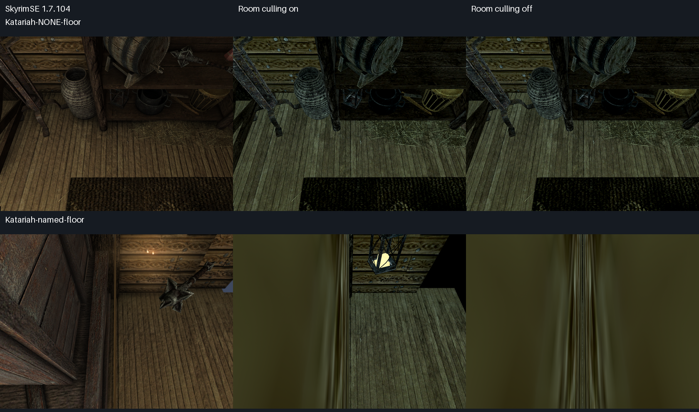
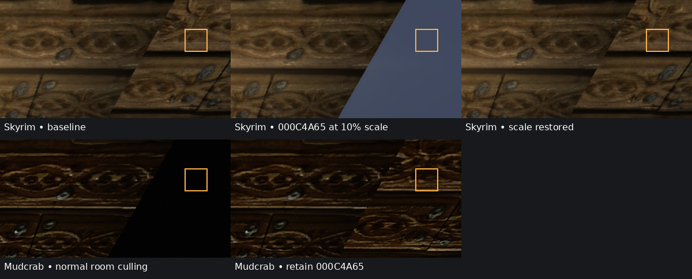

# Authored-assignment retail comparison, 2026-11-17

Fresh original-game captures support the two background-shell removals questioned in review.
Skyrim omits those shells at the matched viewpoints too. This supplies the missing retail oracle for these removals. Authored assignment remains enabled
by default. The comparison does not establish full Skyrim parity.

## Retail oracle for the disputed images

The original game is SkyrimSE.exe 1.7.104.0 under Proton Experimental 11.0-100. Its SHA-256 is
`846efccf0c1374d71f892907f46549560f2fcb0a75cb87a3eed438baa0f1402f`.
Built-in `tfc 1` supplied the free camera. Read-only native probes checked NiCamera RTTI, position,
rotation, field of view, cell, and enabled multibounds before and after every capture.

The 15 retail captures cover five poses three times at 1400×1050. Position errors are below 0.02
Creation units and angular errors below 0.002 degrees. A private Proton prefix disabled autosaves.
The installed executable, preferences, and saves matched all nine pre-run hashes after normal exit.
No debugger attachment or instruction patch was used.
[Executable and camera receipts](evidence/room-review-20261117/retail-captures.json) retain the evidence.

The middle and right columns reuse the historical authored runtime from
[the original validation record](room-authored-assignment-20261115.json), rather than relabeling a
newer combined build as that older layer. Their binary and image hashes are in
[the review receipt](evidence/room-review-20261117/authored-review.json).

At Bleak Falls `room1-c`, the large Nordic room shells in the full-render control are absent in
both retail and authored rendering. At Gallows `inside-out`, retail retains the foreground ceiling
edges and the small right-hand opening while omitting the large shell behind it. Authored rendering
makes the same broad visibility choice. Fog, sky, lighting, some props, and material sampling differ.
This is a geometry-visibility comparison, not an RGB parity measurement.

## Named targets and NONE in Katariah

Katariah01 contains 32 named targets, three NONE overrides, 2,536 automatic rules, and 18 unknown
rules. All five selected cells exported complete. The private fixture rebuilt 1,206 source models.
Unknown rules remain conservative.

The NONE-floor pose is above reference 769925. Its floor remains visible in all three modes while
the enabled mesh list falls from 153 to 63. The named-floor pose is above reference 457767, whose
authored target is room 454223 while the camera lies in room 454224. Its floor remains visible in
retail and the enabled view, with 48 of 255 meshes retained. The full-render control instead covers
much of that view with a close shell surface. Both Mudcrab modes still differ from retail in props
and material sampling. These images do not identify the owner of every visible pixel.

The fresh combined-stack recheck has 48 settled images at eight poses, three runs per mode.
It includes the review toggle and gap fixes plus the upper layer's bounds support. It is recorded
as a combined check, not a standalone rerun of #745. [Inputs, counts, comparisons, and hashes](evidence/room-review-20261117/authored-review.json)
retain that distinction. Local plane/box occluders are absent from both historical and current
executables used here. The broader traversal, lighting, shadows, and moving-deformation limits
remain in the existing research notes.

## Legacy bounds eligibility follow-up

The stored-model-bounds guard applies only to legacy geometric membership. Authored initial
named targets still supply ownership without a model sphere or legacy aggregate bounds. Authored
source spheres still drive ownership and movement updates without that legacy metadata. ECS
controls cover both cases alongside the spanning-floor regression for legacy graphs. This layer
passed all 82 room-culling-related tests after propagation. The retail images above retain their
recorded executables and were not rerun for this missing-metadata guard.

## Assignment cache invalidation

Cached ownership now recomputes whenever the computed cell-local affine transform changes.
A fixed tolerance on matrix entries cannot bound sphere displacement: scaling a source sphere
centered at x=9998 by 1.0005 moves it about five units. The regression keeps one scheduled
system and its local cache across two frames, then verifies reassignment into the visible room.
It failed before the fix and passes afterward; all 84 culling-related tests on the assignment
layer pass. The existing retail captures predate this change and were not rerun.

## Private fixture path validation

The preparation utility checks the supplied asset directory and every ancestor, using an absolute
path, before writing the preparation receipt or opening SQLite for writes. Database hard-link
and direct child-link checks remain in place. The linked-parent regression failed before the fix;
all five utility tests now pass. An actual CLI run with disposable files rejected the linked
ancestor before any write, preserving both the database bytes and an existing receipt. No game
assets were used in that check.

## Subset model replacement

A subset export that changes or removes an existing base model now removes that base's cached
source sphere and marks every referencing cell incomplete in the same transaction. A full room
export rebuilds completeness. Unchanged models retain their spheres and cell metadata; unrelated
bases and cells are untouched. A light that loses its model also loses its old drawable row.

The nonempty-subset regression failed when replacing `A.nif` with `B.nif`: the old sphere survived.
It now covers replacement, removal, and unchanged-model updates for both `STAT` and modeled `LIGH`
records, including affected cells and unrelated controls. This fixes derived ownership metadata;
the existing retail images were not rerun for subset conversion.

## Katariah wall control, 2026-11-19

Skyrim draws carved wood from wall `000C4A65` in the upper-right corner of the named-floor view.
The original Mudcrab run omits this wall at the final drawable visibility test.
At the NONE-floor pose, room culling removes 95 main-camera meshes and leaves the entire PNG identical.

| Settled camera pose | Meshes with room culling | Meshes without room culling |
| --- | ---: | ---: |
| NONE floor | 58 | 153 |
| Named floor | 39 | 255 |

Both runs used the same executable and private pack. The pack rebuilt all 236 requested models for
Katariah01. Each mode reproduced both PNGs byte for byte on a second run. Run the two poses from
the [receipt](evidence/room-review-20261117/katariah-wedge-control.json) with `--shots`, then add
`--shots-no-room-culling` for the control. The retail images are the camera-verified Skyrim
1.7.104 captures from November 17.

In the named-floor view, a close wall (`000BC19E`) covers the disputed corner when room filtering
is off. In a separate database copy we lowered only that placement by 50,000 Creation units.
The exposed 40 × 40 patch at pixel (1320, 50) then showed wall detail with filtering off.
With filtering on, all 1,600 pixels were black at the default grade. Allowing one additional
placement through the filter, wall `000C4A50` (`ShipKatariahWoodWall01.nif`), raised the drawn
count from 39 to 40 and reproduced the exposed off-control patch exactly.

For that intervention, change only the wall's `room_reference_rules.assignment` from `auto` to
`none` in the displaced-wall copy. The same patch matched at a second lighting setting
(`--lights --color-grade off`). Admitting the other nearby wall, `000C4A65`, left 1,571 of the
1,600 pixels different from the exposed off control under that setting. This intervention identifies the surface exposed in the modified Mudcrab scene.

The orange box marks the measured patch. The Mudcrab panels use the second lighting setting and
three times the captured RGB values for legibility. Pixel comparisons use the original PNGs.

### Retail wall identification

In Skyrim SE 1.7.104, shrinking `000C4A65` to 10% at the original pose removed the wood grain in
two trials. Restoring its scale brought the grain back both times. Shrinking `000C4A50` left the
grain visible. The camera, projection and viewport matched across captures, and the live node
sphere confirmed each scale change. Luminance standard deviation in the 40 × 40 patch went from
13.83 to 0.20 in both target trials, then returned to 13.68 and 13.80. The negative control
measured 13.63. [Capture hashes and measurements](evidence/room-review-20261117/katariah-retail-wall-control.json)

Both engines reached the wall's room, `0006EE1E`, from camera room `0006EE50`. At portal
`0006EF37` the Skyrim drawable's sphere extends 67.97 Creation units into the accepted half-space.
Mudcrab tests the transformed mesh box, which falls 41.91 units short of the same plane.
Bypassing that final filter for `000C4A65` in the normal Mudcrab pack restored the wood, with
40 of 255 meshes drawn. The NONE-floor image stayed byte-identical. This identifies a difference
in drawable bounds for this static, single-shape mesh. Both runs already reach its room.

