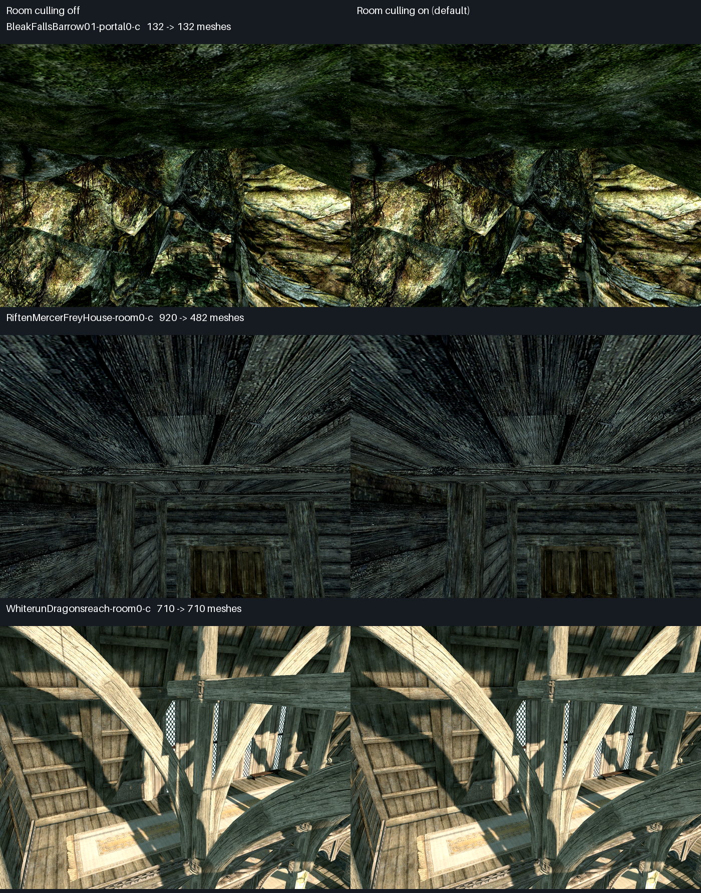

# Room culling review validation, 2026-11-17

Room culling defaults on. **Culling and drawing → Room culling** disables it immediately, and
**Save** keeps that choice across runs. Old settings files default on. Disabling the setting
leaves the main camera's mesh list intact. The stale unavailable message has been removed.

## Core-layer interior captures

The executable contains core commit `19376d359bd911dfed4e2000cd0a7c28694113df`. A private
measurement patch allows benchmarks to hold a settled shot; its guard is absent during these
ordinary captures. The patch changes no room-culling, ownership, or bounds code.

All 18 captures used Vulkan at 1400×1050, with three fresh-process runs per mode. Both sides
used the same executable, models, textures, and poses. The off control removes the four legacy
room tables from an independent database copy. Every capture settled without pending or failed
work. [Pose, count, repeat-image, and executable receipts](evidence/room-review-20261117/core-captures.json)
record the inputs and output hashes.

| Interior viewpoint | Listed | Drawn, off | Drawn, on |
| --- | ---: | ---: | ---: |
| Bleak Falls, portal 0 | 132 | 132 | 132 |
| Dragonsreach, room 0 | 710 | 710 | 710 |
| Mercer Frey's house, room 0 | 920 | 920 | 482 |

Bleak Falls and Dragonsreach have no pixels differing by more than eight in any RGB channel.
Mercer's comparison has one differing pixel, which also changes between repeats of each side.
Removing repeat-varying pixels leaves no stable difference at this threshold. This supports these
sampled viewpoints. It does not prove all interior visibility correct.

## Release frame cost

At the Mercer house pose, the core's median mean frame time was **25.10 ms off and 23.64 ms on**,
a 1.46 ms reduction. Five alternating fresh-process runs per mode each measured 600 frames after
300 warm-up frames. Off-run means ranged from 24.91 to 26.06 ms. On-run means ranged from
23.16 to 24.88 ms. The ranges almost touch, so this is a modest, view-specific result.

The release executable ran on a Ryzen 5 1600 and GTX 1660, driver 595.112.07, with Vulkan and a
native Wayland surface. This timing frame is 1400×900, unlike the 1400×1050 visual captures above.
The narrower frame listed 768 meshes and retained 426 with culling. Both modes used the same
binary and geometry. The off database copy omits room tables. Saved interactive preferences are
intentionally ignored by automated captures; they are tested separately.

The [measurement-only patch](evidence/room-review-20261117/measurement-only.patch) holds the camera
after screenshot readback and starts warm-up then. It changes no culling, ownership, or bounds code. Apply its zero-context hunks with
`git apply --unidiff-zero measurement-only.patch` to the recorded source commit.
All 6,000 measured frames passed renderer proof, with GPU culling, indirect drawing, and HZB active.
No capture timed out or retained pending or failed work. No compiler or other test engine ran during
timing. The starting load average was 2.45 on 12 logical cores. Ordinary desktop apps remained open.

Separate instrumented profiles, excluded from the medians, place most time in the render thread's
graph/presentation interval: 15.75 ms on and 18.14 ms off, with about 6.4 ms in render preparation.
Main-world work was about 5.5 ms. GPU utilization medians were 36% and 39%. These observations
point to the host render/presentation path as the limiter. Native driver stacks were not sampled,
so the cause inside that interval remains unresolved. CPU phases and GPU pass times overlap and
must not be added. [All run means, ranges, profiles, executable identity, and hardware](evidence/room-review-20261117/core-frame-times.json)
retain the limits. This measures a warmed stationary view, not cold loading, continuous motion,
original-game performance, or the separate local occluder implementation.

## Regression checks

The core layer passed 50 culling tests, 59 settings tests with one ignored, formatting, and strict
engine Clippy. The new tests failed before the change. They verify that old preferences default on,
the menu choice saves and reloads, and switching off and back on affects the next frame's mesh list
and capture counts.

## Scope

These captures exercise the coarse core layer, before portal-aperture and authored-assignment
layers. The separate local plane and box occluder implementation is absent from this executable.
Actor spawns report existing unresolved-record warnings in these assets. These references remain outside
room culling. Lighting, shadows, and original-game performance are outside this comparison.

## Missing stored bounds follow-up

A reference without `ExpectedModelBounds` now stays drawn under legacy room membership. The
converter can write its pivot row without any bounds-overlap rows when `bounds_valid=0`. A loaded
mesh AABB does not establish that the stored memberships cover its full extent. The eligibility
check reads the existing component on the reference root before applying room rejection.

The spanning-floor regression failed before this guard, with its rear-room pivot causing the
visible forward portion to disappear. It now passes. The streamed override fixture also verifies
that NONE and unknown-bounds references stay drawn while a bounded automatic reference is culled.
Synthetic fixtures that represent complete membership now explicitly supply stored model bounds.
The updated core passed all 1,611 engine tests with 11 ignored, formatting, and strict engine
library/test Clippy. This run includes 51 room-culling tests. Earlier screenshots and timing remain
pinned to their recorded executable; they were not rerun for this missing-metadata guard.
