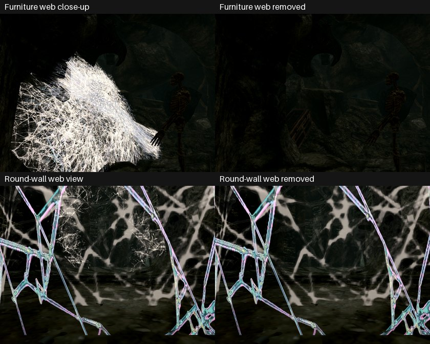

# Web and foliage culling mismatches

The original-game comparison exposed two confirmed causes of overdraw: missing source bounds
for foliage and effect-node hierarchies, and blanket activator exemptions. The first fixes removed
distant webs and ferns in the captures while retaining them in matched close-up controls.

The [machine-readable report](room-culling-mismatches-20261115.json) records native bounds,
reference identities, source fingerprints, repeated render receipts, and checks. The local evidence
bundle is named `skyrim-culling-mismatches-20261115`. It contains native
reference probes, screenshots, capture logs, the contact sheet, and the comparison viewer.
No proprietary assets or native instructions are included in the repository.

## Missing bounds bypassed assignment

`BSLeafAnimNode` roots were unparsed, so the source-sphere walk returned unknown. Gallows Rock
ferns therefore used the conservative draw-always policy. `BSOrderedNode` parents and empty
`BSBlastNode` children also interrupted the bound walk in effect models.

The converter now parses leaf nodes as node hierarchies, merges ordered-node child spheres, and
accepts zero-sphere empty blast nodes. Nonempty damage ranges remain unsupported. An ordered
node's loader derives its runtime fixed-bound flag from its static-bound byte and sort-bound
radius. A nonzero byte and nonzero radius enable the override, independently of the serialized
flag. Zero or unordered radius comparisons clear the flag. Source-sphere validation still
rejects invalid bounds.

The format definitions are in [NifTools' schema](https://github.com/niftools/nifxml/blob/develop/nif.xml).
Exact-build RTTI and vtable inspection independently confirmed that `NiNode`, `BSLeafAnimNode`,
and `BSOrderedNode` use bound-update RVA `0xee2920`. Ordered downward update RVA `0x1570720`
then applies the explicit-bound override using that derived state. Loader RVA `0x15702b0`
establishes how the runtime flag differs from the serialized bit. Serialized node layouts alone
would not establish those runtime rules.

Live probes of fern references `00042152`, `00042179`, `00042184`, and `00042185` found them
under native `BSMultiBoundRoom` nodes. Their converted spheres, transformed by the live native
root transforms, agree with native world bounds within 0.000123 Creation units.

## Activators with usable bounds follow room assignment

The conspicuous white web in the distant Bleak Falls Barrow view includes activators
`000800D5` and `000AA83F`. Skyrim attaches the first to a room and the second to a
`BSPortalSharedNode`. Mudcrab previously exempted every activator and withheld bounds from
every declared skin.

Activators now use the same supported, moving-root assignment policy as loose objects. Legacy
graphs retain their exemption. Self-contained skins can retain source spheres when their bones
have a fixed pose. External or unresolved rigs, simulated or keyframed skin bodies, animated
skin bones, constraints, and unknown bound hierarchies keep the conservative fallback. Actors
and animated doors retain their separate exemptions.

The physics check reads original rigid-body fields independently of collision export. At capture
time, the web door's motion system 5, quality 0, and mass 0 were classified as fixed. Its collision
layer 20 is not exported by the physics reader. The later automatic-quality guard at `62abaf8f`
rejects this combination as proof of a fixed skin pose. Current conversion omits this model's
assignment sphere and keeps it conservatively drawn. A skipped collision layer must not conceal
a moving bone body.

Export preparation uses one immutable NIF byte snapshot for scene parsing, collision extraction,
and the fixed-pose gate. Replacing a loose NIF after that read cannot authorize a sphere for
different geometry. The gate rejects keyframed bodies independently of mass and quality. A
mesh-output contract invalidates assignment metadata produced before these corrections.

At the captured poses, nine skinned web references across the door and round-wall models
matched live native spheres within 0.000143 Creation units. The web-door model radius was
241.229568, including the native scale of each placement. Physics-deformed corpse models
differ substantially from their source poses and receive no source-sphere assignment metadata.

The retail activator `FXcobwebRoundWall01ACT` (base form `0001EEB9`) has placements
in Bleak Falls Temple, Cronvangr Broodlair, and Honningbrew Basement. Its model,
`Effects/FXcobwebRoundWall01.nif`, is a 40,221-byte member of `Skyrim - Meshes0.bsa` in the tested Steam
app 489830 build 24914197 (archive SHA-256
`f3de11a1fcbd8b3e9582d5981be815c2c5f160f5be21044479e318de8a5183e9`).
The unpacked member and the archived corpus input both hash to
`467aedb10d5c8913f463de55df50be9dc07e64692119734ca1ba00c4fa9a55de`.
Its root controller manager (block 3) lists the `partB` and `partA` sequences (blocks 5
and 13). Both target `bone01` by name through a `NiMultiTargetTransformController`
(block 4). The object palette maps that name to node 24. Both `NiSkinInstance` blocks
(28 and 34) reference node 24 and have positive weights for it in their `NiSkinData`
(42 and 34 entries, respectively). The sequences supply translation keys for that bone.
The converter omits `mudcrabRoomSphere` for the animated skin. At the time of the captures,
the engine skipped every reference model under `effects/`, including this web. The streaming
path now requests its converted GLB.

### Bleak Falls web controls, 2026-11-20

The combined Mudcrab engine at `c3fa2555` rendered both web models in Bleak Falls Temple
using the 989-model conversion at `be483676`. Each pose produced byte-identical 1400 × 1030
PNGs with room culling on, off, and on a repeat of each mode. The controls cleared only the
selected web model path in separate private database copies. All 16 captures settled.
Exterior LOD was omitted from all copies. Unresolved NPCs were skipped at both poses.

| Camera | Meshes drawn, on / off | Pixels changed by removing the round-wall web | Pixels changed by removing the furniture web |
| --- | ---: | ---: | ---: |
| Original web-door close-up | 156 / 666 | 0 | 487,334 |
| East-facing round-wall view | 118 / 567 | 122,037 | 654,240 |

Each pixel count uses a difference greater than 8 in any RGB channel and was the same in
both culling modes. The first pose shows only the furniture web of the two tested models.
Both contribute at the east-facing pose. The second pose has no matched retail capture.
Camera positions, orientations, mesh counts and image digests are in the
[capture receipt](evidence/room-review-20261117/bleak-falls-web-controls.json).



## Rendered verification

The original private comparison reconverted 989 models without conversion failures. Source bounds increased
from 2,799 to 2,842 base records. A named mesh-output contract invalidates earlier cached GLBs;
normal asset reconversion is required to recover the new bounds. The installed asset pack was
not modified.

Six camera poses use 1400 × 1030 captures and the native camera's measured 75° horizontal FOV.
Four reproduce the earlier comparison. Two additional native close-ups show the affected web
and fern where they should remain visible. Three independent runs per Mudcrab mode produced
36 captures. All settled without timeouts or pending/failed room graphs.

| Pose | Persistent changed pixels, before versus fixed culling | Fixed culling versus full rendering |
| --- | ---: | ---: |
| Bleak distant shell | 14099 | 322172 |
| Bleak joined-room cave | 0 | 0 |
| Gallows outside, facing away | 11410 | 359811 |
| Gallows inside, facing out | 10764 | 208435 |
| Visible web close-up | Not compared with the old engine | 0 |
| Visible fern close-up | Not compared with the old engine | 0 |

These counts compare Mudcrab images across all nine repetition pairs at a per-channel threshold
of 8. They do not measure speed or RGB equality with Skyrim. The full-render control changed
by one persistent pixel in the Bleak shell view and zero in the other three historical views.
The visible geometry removals therefore come from culling, rather than changing the mesh pack's
rendered content. The historical 989-model hash recheck after tightening rig eligibility found
no changes from the captured pack. That check predates the leaf scene-node export fix at
`f6b9b196` and does not verify later converter heads. A fresh comparison must distinguish
container metadata changes from geometry and drawable-transform changes.

Regression coverage checks leaf geometry and exported bounds, ordered-node loader state, empty
versus nonempty damage stages, fixed versus moving bodies on unexported collision layers,
external versus self-contained skins, and moving activator assignment. Validation passed:
1,453 engine tests, 1,206 converter tests, 14 skin-export tests, seven archive tests, and four
snapshots. Forty-three tests remain ignored. Formatting and Clippy for engine/converter, all
targets and features with warnings denied, passed.

## Later converter recheck

All 989 captured source NIFs converted after the leaf-export and
ordered-node loader fixes at `3abaeb8eb03a312a5c2fe4f50b25f25695badac8`. The
comparison used the exact extracted source bytes and verified the captured GLB hashes before
conversion. It found 631 changed GLB hashes. Every model retained identical vertex and index data,
primitive geometry, drawable transform paths, and drawable instance, primitive, and triangle counts.

The byte differences have three causes, with overlap between the first two groups:

- 617 models gain `mudcrabGeometryIndex` in primitive extras. All other mesh fields match.
- 16 leaf-root models gain an identity scene wrapper. None gains rendered geometry. They are
  `meshes/landscape/plants/pineshrub01snow.nif`, `reachfern02.nif`, `reachfern03.nif`,
  `swordfern01.nif`, `swordfern05.nif`, `swordferncluster01.nif` through `swordferncluster06.nif`,
  `thicket01.nif`, and `vinemaple01.nif` under that same directory, plus
  `meshes/plants/florahangingmoss01.nif` through `florahangingmoss03.nif`.
- `meshes/furniture/fxspiderwebkitdoorspecial.nif` loses its assignment sphere because of the
  automatic-quality guard described above. Its ten drawable meshes and 1,588 triangles match.

The 16 leaf models retain 7,903 triangles in total. A nested-leaf regression verifies child
transforms and geometry, but this corpus contains only leaf roots. The fresh model comparison
does not rerun the historical images or establish current web-door culling behavior. Native
classification of its animated pose remains unresolved.

The original `mesh-hash-check.json` has SHA-256
`2187eb0236c32ab16b23190d83efc1fb436c178f15d4b8d688154b4d823e6379`.
Set `CORPUS_WORKTREE` to a clean checkout of the recorded commit. Set
`CAPTURE_DIR` to the private capture directory with `room-assignment-nifs/meshes`,
`assets/meshes`, and `captured-mesh-hashes.json`. Set `SOURCE_INVENTORY` to the review's
`source-inventory.json` and `CORPUS_OUTPUT` to a fresh directory path. Run the
comparison script from this repository:

```sh
python3 docs/research/evidence/room-culling-corpus-20261118/check-mesh-corpus.py \
    --worktree "$CORPUS_WORKTREE" \
    --sources "$CAPTURE_DIR/room-assignment-nifs" \
    --captured-assets "$CAPTURE_DIR/assets" \
    --captured-hashes "$CAPTURE_DIR/captured-mesh-hashes.json" \
    --source-inventory "$SOURCE_INVENTORY" \
    --output "$CORPUS_OUTPUT"
```

The script verifies both manifest digests and every input hash. For changed GLBs it compares
the mesh transform paths and the ancestry and local transforms of every joint used by a drawable
in the active scene. The receipt includes the converter command.

At `d0e275e4`, all 989 source NIFs reconverted. Compared with the original captured GLBs,
632 file hashes changed. The binary geometry, primitive geometry, drawable transform paths,
and drawable counts matched for every model. Compared with the earlier `3abaeb8e` conversion,
only `meshes/effects/fxcobwebroundwall01.nif` changed, dropping its fixed room-assignment
sphere. The new comparison receipt has SHA-256
`beab170a3b6204145a996bd30d4835eca2bff52803659443406d0e7f40f297b0`.

A recheck of the 989 archived `505566f6` outputs verified their hashes against that conversion's
receipt. Of the 788 files whose hashes differed from the original captures, two had drawables
with skins. Their joint paths and transforms matched. A synthetic sibling-joint control detected
changes to the joint translation, its parent's translation, and the joint's parentage.

At `be483676`, all 989 archived NIFs reconverted successfully. Compared with the verified
`505566f6` GLBs, 42 models lost their assignment sphere and 20 received a different sphere.
The other 927 GLBs matched byte for byte. Binary chunks, primitive geometry, drawable and
joint transform paths, and draw counts matched across all 989 models. The four measured
fern placements retained their model spheres. Both web models continued to omit theirs.
The private sphere comparison receipt has SHA-256
`04f27474bf94b935701db30c39de44778ef2447d4a37e2836b8f8aa2fe3b2cf6`.

## Remaining differences

The close-up still shows corpse pose differences in both culled and full rendering: native
ragdolls have settled, while Mudcrab renders bind poses. Their native bounds cannot be recovered
by labeling an undeformed source sphere as exact. Lighting, fog, water, material brightness,
actors, and other unsupported assignment paths also remain outside this comparison's parity
claim. These fixes establish the targeted web/foliage behavior, not complete Skyrim parity.

Skyrim exited without saving, temporary preferences were restored, the pose batch was removed,
and the private display was stopped.

## Human review recheck, 2026-11-17

The [fresh review comparison](room-assignment-review-20261117.md) supplies matched retail images
for the previously disputed shell views and adds Katariah named-target and NONE coverage. The
[combined frame-cost record](room-culling-combined-review-20261117.md) uses the latest reviewed code
with no local occluders. Its timing ranges overlap, so it does not establish a reliable speedup.
